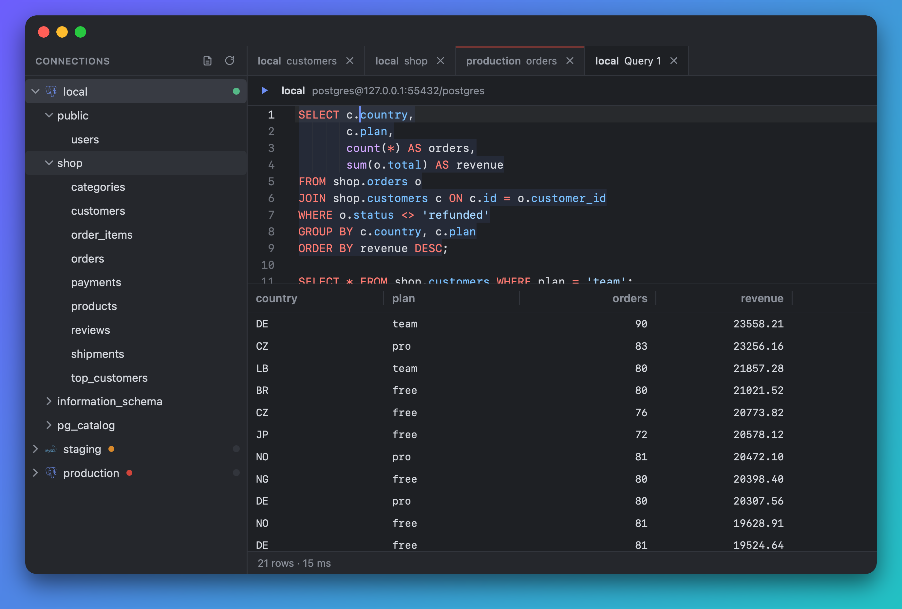
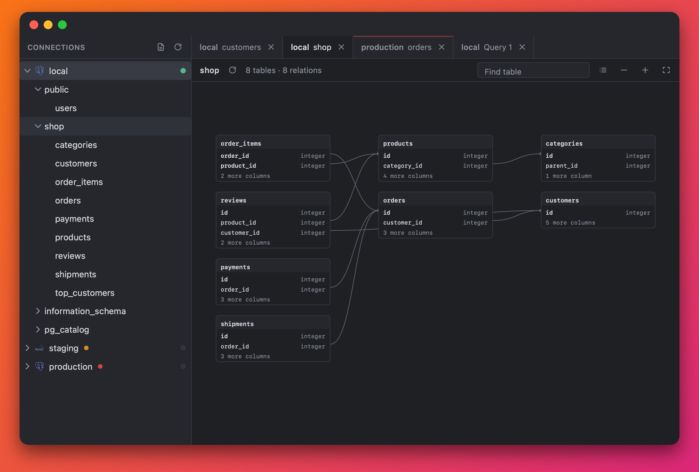

<h1 align="center">PixelRow</h1>

<p align="center">
  A small desktop database client, written in Go.
</p>

<p align="center">
  
</p>

> [!NOTE]
> PixelRow is still small and has a lot of growing to do. It is developed on macOS, there are no prebuilt downloads yet, and things will change.

## Features

- **Connections**: several open at once, each in its own tabs, read from a TOML file.
- **SQL editor**: syntax highlighting, and completion for tables, columns and aliases.
- **Running queries**: the selection or the statement at the caret with <kbd>Cmd</kbd>+<kbd>Enter</kbd>, everything with <kbd>Cmd</kbd>+<kbd>Shift</kbd>+<kbd>Enter</kbd>. Rows load as you scroll, and a running query can be cancelled.
- **Tables**: data, columns, indexes, foreign keys and DDL. Cells and rows can be edited where the table has a primary key.
- **Diagrams**: an entity-relationship diagram of a schema, or of one table and what refers to it.
- **Dump and SQL files**: dump with `pg_dump` or `mysqldump`, and run a SQL file with `psql` or `mysql`.
- **SSH tunnels**: reach a database behind a bastion through your own `ssh`.
- **Color and read-only**: mark a connection with a color, and keep the app from writing to it.

<p align="center">
  
</p>

## Getting started

You need [Go](https://go.dev/dl/) 1.27 or later.

```sh
git clone https://github.com/v420v/pixelrow.git
cd pixelrow
go tool mygo dev      # run it, reloading as the code changes
go tool mygo build    # package it as an app into build/
```

On the first start PixelRow creates `~/.config/pixelrow/config.toml` with commented examples. Add a connection and press Reload:

```toml
[connections.local]
kind = "postgres"       # or "mysql"; postgres when left out
host = "127.0.0.1"
port = 5432
user = "postgres"
password = "postgres"
database = "postgres"
```

Want something to connect to? The repository has a `compose.yaml` with two PostgreSQL servers and a MySQL server:

```sh
docker compose up -d --wait
```

## Configuration

The file is at `$XDG_CONFIG_HOME/pixelrow/config.toml`, or `~/.config/pixelrow/config.toml`. Each `[connections.<name>]` table is one connection.

> [!WARNING]
> Passwords are stored in this file as plain text. PixelRow creates it readable by you alone (`0600`). Keep it that way.

### Color and read-only

```toml
[connections.production]
host = "db.example.com"
user = "app"
password = "secret"
database = "app"
color = "#dc2626"       # #rgb or #rrggbb
readonly = true
```

### SSH tunnel

`host` is the database as the SSH server sees it.

```toml
[connections.production]
host = "db.internal"
user = "app"
password = "secret"
database = "app"

[connections.production.ssh]
host = "bastion.example.com"
user = "me"
port = 22                     # ssh's own default when left out
key = "~/.ssh/id_ed25519"     # ssh picks a key itself when left out
passphrase = "..."            # when the key has one
password = "..."              # when the server asks for one as well
```

A host that is already set up in `~/.ssh/config` takes one line: `ssh = "bastion"`. The server's host key must be known already, so connect to a new bastion once from a terminal first.

### Tools

PixelRow looks for `pg_dump`, `psql`, `mysqldump`, `mysql` and `ssh` on your `PATH` and in the usual Homebrew, Postgres.app and Nix places. Tell it where they are when it does not find them:

```toml
[tools]
pg_dump = "/opt/homebrew/opt/libpq/bin/pg_dump"
psql = "/opt/homebrew/opt/libpq/bin/psql"
mysqldump = "/opt/homebrew/opt/mysql-client/bin/mysqldump"
mysql = "/opt/homebrew/opt/mysql-client/bin/mysql"
```


## Contributing

Issues and pull requests are welcome.

The PostgreSQL and MySQL logos are trademarks of their owners and are used only to tell connections apart. See [internal/app/logos](internal/app/logos/README.md).
